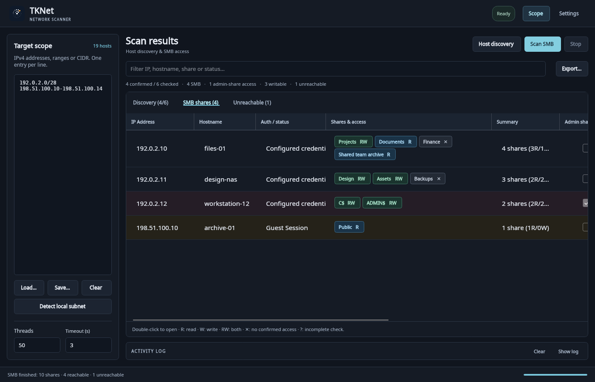

# TKNet

IPv4 host discovery ve SMB paylaşım incelemesi için Go motoru ve Avalonia/.NET 10 masaüstü arayüzü. Desteklenen paket hedefleri Linux x64 ve Windows x64'tür.



| İşlev | Davranış |
| --- | --- |
| Host discovery | Varsayılan olarak yalnız doğrulanmış canlı hostları gösterir; IP listesi TXT/JSON ve tam JSON kanıt raporu sunar |
| SMB inceleme | Sağlanan hesapla paylaşım listesi, kök okuma/yazma erişimi ve erişim hatalarını gösterir |
| Paylaşım açma | Linux'ta Dolphin'e ayarlardaki hesabı aktarır; Windows'ta Explorer oturumunu kullanır |
| Sonuç yönetimi | Sayısal IP sıralaması, metadata filtresi, CSV dışa aktarma ve sınırlı boyutlu günlük |

Kendi yönettiğiniz veya tarama izniniz olan ağlar için tasarlanmıştır. [MIT](LICENSE) lisanslıdır; bağımlılıkların kendi lisansları [üçüncü taraf bildirimlerinde](THIRD_PARTY_NOTICES.txt) korunur.

## Çalıştırma

- Linux: `release-linux/TKNetUI`
- Windows: `release/TKNetUI.exe`

İlgili release klasörünün tamamını, yerel kütüphaneleriyle birlikte taşıyın. Linux paketi .NET çalışma zamanını içerir; masaüstü sistem kütüphanelerini içermez. ICMP için `ping`, ARP rota seçimi için `iproute2`, ARP gözlemleri için desteklenen `arping` ve işletim sistemi izinleri gerekir.

Arayüz; esnek kapsam editörü, paylaşım erişimini öne çıkaran sonuç tabloları, kaydırılabilir ayarlar paneli ve açılıp kapanabilen günlük içerir. Küçük pencerelerde daha sıkı yerleşime geçer.

`Ctrl+F` sonuç filtresine gider; filtrede `Esc` aramayı temizler. Ayarlarda `Esc` paneli kapatır. Paylaşım etiketleri klavyeyle odaklanabilir ve `Enter` ile açılabilir. Discovery sekmesindeki `görünür/toplam` sayacı, yanıtsız adresler gizlendiğinde de gösterilir. CSV, seçili sekmenin filtre dışında kalan kayıtlarını da içerir.

Keşif tamamlanınca **Export → Alive IPs (TXT)** veya **Alive IPs (JSON)** ile yalnız doğrulanmış canlı adresleri kaydedin. TXT başlıksız, BOM içermeyen UTF-8 metindir; her satırda tek IP bulunur. JSON yalnız IP metinlerinden oluşan bir dizidir. İki çıktı da tekilleştirilir, sayısal sıralanır ve ekran filtresinden bağımsızdır. Durdurulmuş veya tamamlanmamış taramalarda bu seçenekler açılmaz; tanılama için tam discovery raporu kullanılabilir.

TXT dosyasını Nmap'e doğrudan verebilirsiniz: `nmap -iL alive_ips.txt`. Nmap'in kendi keşfini atlayarak listedeki bütün adresleri taramak için `nmap -Pn -iL alive_ips.txt` kullanılır; adresler TKNet keşfinden sonra durum değiştirmiş olabilir. JSON dosyası otomasyon içindir, Nmap `-iL` girdisi değildir. [Nmap hedef listesi](https://nmap.org/book/man-target-specification.html), [keşif seçenekleri](https://nmap.org/book/man-host-discovery.html).

Scope tek IPv4, IPv4 CIDR (`/0`–`/32`), kısa/tam IP aralığı ve virgül/satır ayrımını destekler. Birden fazla büyük CIDR birlikte kullanılabilir; 65.536 adres sınırı yoktur. Çakışan aralıklar tekilleştirilir, hedefler sayısal IP sırasıyla ve tüm adresler baştan belleğe açılmadan işlenir. `/31` ve `/32` tüm adresleri içerir; daha büyük CIDR'lerde yalnızca o ağın network/broadcast adresleri dışarıda kalır. 1–256 işçi ve 1–60 saniye timeout desteklenir. Tarama süresi ve biriken sonuçların bellek ihtiyacı kapsamla birlikte artar; scope metni/dosyası için 1 MiB karakter sınırı sürer. Discovery sonuçlarında **No response**, kapalı cihaz anlamına gelmez. [Keşif davranışı](docs/HOST_DISCOVERY.md).

SMB paylaşımına çift tıklama Linux'ta Dolphin'i açar. Ayarlarda kullanıcı adı varsa kullanıcı/domain/parola, masaüstünün D-Bus oturumu üzerinden Dolphin'e aktarılır; TKNet parolayı günlüğe, kopyalanan bağlantıya veya başlattığı sürecin komut satırına eklemez. Bu akış Dolphin, KIO SMB desteği ve çalışan masaüstü oturumu gerektirir. Aktarım başarısızsa açık hata gösterilir; kimlik bilgileri sessizce atılmaz. Hash modunda hash Dolphin'e parola olarak gönderilmez; Dolphin parola veya kayıtlı oturum ister. Kullanıcı adı girilmemişse Dolphin/varsayılan dosya yöneticisinin oturumu, Windows'ta ise Explorer oturumu kullanılır. [SMB–Dolphin davranışı ve doğrulama sınırları](docs/SMB_DOLPHIN.md).

SMB yazma kontrolü disk paylaşımının kökünde yeni bir geçici dosya oluşturup siler; `CanWrite` bu işlemi ifade eder, tüm dizinlerin ve dosyaların yazılabilirliğini değil. Sunucunun bildirdiği tür korunur; yazıcı/aygıt/IPC kaynakları listede kalır, ancak dosya erişimi test edilmez ve dosya yöneticisinde dizin olarak açılmaz. `Admin share` da idari paylaşıma erişim gözlemidir; yerel Administrators üyeliğinin kanıtı değildir.

SMB listeleme devam sayfalarını aynı oturumda toplar. Listeleme veya erişim kontrolü yarıda kalırsa bilinen paylaşım adları korunur; `Incomplete`, `Enumeration failed` ve `?` göstergeleri belirsizliği belirtir. Bunlar erişim reddi veya “paylaşım yok” sonucu değildir. SMB için timeout ayarı TCP bağlantısına uygulanır; protokol işlemlerinin hareketsizlik süresi en az 30 saniyedir ve veri akışı sürdükçe yenilenir. Sağlanan hesapla giriş başarısız olup Guest kullanılırsa daha sınırlı görünürlük ihtimali açıkça bildirilir.

SMB taraması ping/ARP/discovery ön koşulu kullanmaz; doğrudan TCP 445 ve SMB ile
çalışır. Kimlik doğrulama başlamadan önce geçici TCP bağlantı hatalarında en çok
3 deneme yapılır; ilk geçiş tamamlanınca bağlantı kurulamayan hedeflere en çok
8 eşzamanlı işçiyle tek ek deneme uygulanır (Threads daha düşükse o sınır korunur).
Timeout her bağlantı denemesine uygulanır; son doğrulama taramayı uzatabilir. Başarılı bağlantı
aynı SMB oturumunda kullanılır. TCP yeniden denemesi hesabın yeniden
doğrulanması değildir. Deneme sayıları, kurtarılan bağlantılar ve paylaşım
erişim hataları Activity/Diagnostics içinde görünür. Ayarlar → SMB inspection →
**Export SMB report (JSON)**, erişilemeyen IP'ler dahil son taramanın tüm
sonuçlarını dışa aktarır; kullanıcı/domain/parola/hash ve SNMP community rapor
ayarlarına dahil edilmez. Sonuçlarda kurumunuza ait IP ve paylaşım adları yer
alır. Yeni tarama önceki sonuçları temizler; karşılaştırmak için önce raporu
kaydedin. Geçici SRVSVC pipe meşguliyetinde pipe açma aynı oturumda sınırlı
olarak yeniden denenir; yeni giriş yapılmaz.
[SMB sonuçlarının yorumlanması ve doğrulama testleri](docs/SMB_REPORT_REVIEW.md).

Kök dizini listeleme reddedilirse paylaşım adı listede kalır. Yazma kontrolü atlanır ve CSV ayrıntılarında `[-?]` görünür. JSON raporundaki `ReadCheck` ve `WriteCheck` alanları her iki iznin sonucunu taşır. **Configured credentials** oturum açarken gönderilen hesabı belirtir. Sunucu bu hesabı Guest kimliğine eşleyebilir. Önceki entegrasyonlar için JSON içindeki `Status` alanı korunur.

**Settings → SMB inspection → Resolve hostnames after SMB inspection** seçeneği, paylaşım işlemi tamamlandıktan sonra sistemin ad çözümleyicisine erişilen adresi sorar. Seçenek varsayılan olarak kapalıdır. Ad bulunamazsa Hostname alanı boş kalır.

Uygulama logosunun kaynağı [sonar-uygulama.ico](TKNetUI/Assets/sonar-uygulama.ico) dosyasıdır; pencere, Windows uygulama dosyası ve arayüz başlığı aynı logoyu kullanır.

## Mimari

- `engine_main.go`: tek istek alan headless JSON satır protokolü; sonuçlar `done` öncesinde boşaltılır. Başarısız istek sıfırdan farklı çıkış kodu verir.
- `scanner/`: işçi yaşam döngüsü, config doğrulaması, discovery kanıtı ve SMB işlemleri.
- `netutil/`: platform probları, IPv4 kapsamı ve isteğe bağlı metadata.
- `TKNetUI/`: Avalonia ekranı, `EngineClient`, ayrı sonuç modelleri, dosya dışa aktarımı, paylaşım bağlantıları, Dolphin'e kimlik bilgisi aktarımı ve motor önbelleği.
- `ui/`, `main.go`, `bundled.go`: eski Fyne arayüzü; yayımlanan uygulamanın giriş noktası değildir.
- `tools/discovery_compare.py`: kayıtlı raporları bağımsız cihaz durumu bilgisiyle çevrimdışı karşılaştırır.

## Geliştirme ve derleme

Kaynak koddan derlemek için Go 1.27.4 veya üstü ve .NET 10 SDK gerekir. Hazır paket kendi .NET çalışma zamanını içerir. Tüm eski Go arayüz paketlerini de derleyen `go test ./...`, Fyne'ın masaüstü geliştirme kütüphanelerini gerektirebilir. Headless paketlemede Fyne arayüzü derlenmez.

`go.mod` Go sürümünün alt sınırını belirler. `global.json`, .NET 10 SDK ailesinden 10.0.115 veya daha yeni uyumlu bir sürümü seçer. Ubuntu/Debian'da kalite kontrollerinin masaüstü derleme bağımlılıkları `libgl1-mesa-dev`, `xorg-dev`, `libxkbcommon-dev` ve `libfontconfig1` paketleridir. Dolphin kullanımında ayrıca Dolphin ve KIO SMB desteği gerekir.

Linux: `./build.sh`; Windows: `build.bat`. Betikler kendi klasöründen çalışır, hedef platformun motorunu geçici dizinde yeniden derler ve bu motoru uygulamaya gömer. Başarısız derleme/yayımlama mevcut release paketini korur; eksik çalıştırılabilir dosya veya yerel kütüphanelerle paket değiştirilmez. Yeni ikon ve arayüz varlıkları proje dosyasından otomatik alınır.

Her iki betikte özel Go/.NET çalıştırılabilir dosyaları `GO_BIN` ve `DOTNET_BIN` ile seçilebilir; yollar boşluk içeriyorsa değişken değerine ek tırnak koymayın. `tools/check.sh` ayrıca `PYTHON_BIN` değişkenini destekler. Betikler aynı çalışma kopyasında `.tknet-build.lock` kilidini paylaşır. Kesilmiş bir çalışmadan sonra kilit kalırsa önce çalışan derleme olmadığını ve `.tknet-build*` dizinlerindeki kurtarma kopyalarını kontrol edin; ardından yalnız boş kilit dizinini kaldırın.

Linux'ta sistemdeki `dotnet` proje SDK’sını bulamazsa `build.sh` ve `tools/check.sh` kullanıcı kurulumunu (`~/.dotnet/dotnet`) dener. Bu kurulumla aşağıdaki `dotnet` komutlarını elle çalıştırmak için `~/.dotnet` dizinini PATH’in başına ekleyebilirsiniz. IDE çalıştırmalarında gömülü motor bulunmazsa uygulama kendi çalıştırılabilir dosyasının yanındaki `tknet-engine` (Windows'ta `tknet-engine.exe`) dosyasını kullanır.

İlk bağımlılık hazırlığından sonra kalite kontrolleri:

```sh
go mod download
dotnet restore TKNetUI/TKNetUI.csproj
dotnet restore tests/TKNetUI.Tests/TKNetUI.Tests.csproj
dotnet restore tests/TKNetUI.VisualChecks/TKNetUI.VisualChecks.csproj
bash tools/check.sh
```

Test betiği Go yarış denetimini/vet'i, C# mantık ve süreç testlerini, arayüz derlemesini, çevrimdışı rapor ve paketleme testlerini çalıştırır. Windows adımları [kalite iş akışında](.github/workflows/quality.yml) yer alır. Testler bağımsız cihazlara tarama başlatmaz.

Gerçek Avalonia kontrollerinin sentetik verilerle oluşturulan 22 ekran durumu da denetlenir; PNG dosyaları ve yerleşim raporu `artifacts/ui-preview` içine yazılır. Dosya seçme penceresi açıkken sonuçlar değişse bile dışa aktarılan verilerin aynı taramaya ait kaldığı da kontrol edilir. [Görsel test programı](tests/TKNetUI.VisualChecks/README.md).

Linux'ta isteğe bağlı Dolphin testleri (özel yerel D-Bus oturumu oluşturma izni gerekir):

```sh
dotnet run --project tests/TKNetUI.Tests/TKNetUI.Tests.csproj --no-restore -- --dolphin-dbus
dotnet run --project tests/TKNetUI.Tests/TKNetUI.Tests.csproj --no-restore -- --dolphin-native
```

İlk komut sahte Dolphin ile kimlik bilgisi aktarımını sınar; ikinci komut kurulu Dolphin'i geçici ayarlarla, görünür pencere açmadan çalıştırıp yalnız yerel bir test klasörüne yönlendirir. İkisi de gerçek SMB sunucusunda oturum açma testi değildir.

İsteğe bağlı SMB birlikte çalışma testi: `python3 tools/test_smb_loopback.py`. Python `impacket`, Go ve yerel soket açma izni gerektirir. Yalnız `127.0.0.1` üzerinde geçici SMB2 sunucusu, yapay hesap ve geçici dizinler kullanır; çok sayfalı tam/kısmi listeleme, Unicode/gizli adlı paylaşımlar, boş dizinler ve yazma kontrolünün temizliğini sınar. Impacket uygulamanın çalışma zamanı bağımlılığı değildir.

[Keşif sonuçlarının bağımsız verilerle karşılaştırılması](docs/DISCOVERY_ACCEPTANCE.md)

## GitHub yayını ve katkı

[Yayın doğrulaması](docs/RELEASE_READINESS.md) platform testlerini ve doğrulanan paketleri listeler. GitHub Actions; Linux kalite kontrollerini, sentetik arayüz testlerini ve Linux/Windows paket üretimini çalıştıracak şekilde hazırlanmıştır. İş akışı doğrudan yayın veya otomatik merge yapmaz.

[Katkı rehberi](CONTRIBUTING.md) · [Güvenlik bildirimi](SECURITY.md) · [Değişiklik kaydı](CHANGELOG.md)

Ağ kapsamlarını, raporları ve kendi adınızla kaydettiğiniz dışa aktarımları `reports/` altında tutun. Bu klasör, yerel yedekler ve derleme çıktıları Git dışında tutulur. Kaynak kodu paylaşırken `LICENSE` dosyasını, hazır paket dağıtırken `LICENSE` ve `THIRD_PARTY_NOTICES.txt` dosyalarını koruyun.
